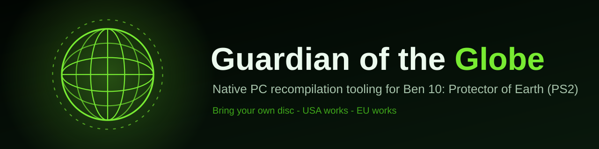



# Guardian of the Globe

Native PC recompilation tooling for **Ben 10: Protector of Earth** (PS2). Pick your own disc image, build it on your PC, play it. Windows only.

**Website:** https://eliasm108.github.io/guardian-of-the-globe/

## Status

| Version | Game ID | State |
|---|---|---|
| USA | SLUS_216.61 | Works |
| Europe | SLES_549.51 | Works (region fix included) |

## Quick start

1. Download this repository as a ZIP and unzip it anywhere.
2. Run `Guardian of the Globe.exe`.
3. Choose your own disc image. The version is detected automatically.
4. Press Build (a few minutes, once), then Play.

The app downloads its own build tools the first time. Nothing from the game is ever uploaded or shared.

## What is new

- **Europe fix.** The EU version showed a black screen because a streaming callback was lost when the answer arrived too early. Fixed in the runtime, see `docs/EU-region-fix.md`.
- **New launcher.** Black and green glass interface with a guided install flow.

## Legal

This project contains tooling, configs and patches only. It does not include the game, and you must supply a disc image you own. Do not share built executables or generated code, because they contain the game's code. This is an unofficial fan project, not affiliated with or endorsed by the owners of Ben 10 or the game. All trademarks belong to their owners.

## Credits

Based on open-source work by exoteric33 and Samir Nuri (MIT). See `NOTICE.md` and `LICENSE`.

